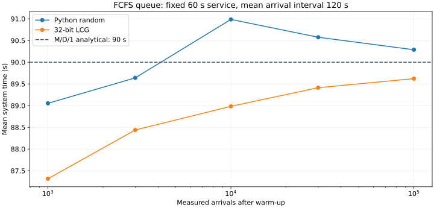

# M/G/1 Queue Simulation

Educational FCFS single-server queue simulation, maintained by Mateusz Sury.
Arrivals are Poisson with mean interarrival time 120 seconds. Service durations
have mean approximately 60 seconds, selected from constant, uniform,
exponential or nonnegative truncated normal distributions.

```sh
python _built-in_library.py
python own.py
python -m unittest -v
```

Python 3.10+ and its standard library are sufficient. Both entry points use the
same queue model; `own.py` substitutes a seeded 32-bit LCG so generator effects
can be compared. The built-in generator is the reference for statistical checks.

The simulation accumulates absolute arrival times. Each service starts at the
later of its arrival and the previous departure. Results distinguish waiting
time from total time in the system; the first 1000 arrivals are warmup.
For utilization 0.5, M/D/1 has mean waiting time 30 seconds and system time 90
seconds. M/M/1 has system time 120 seconds. Finite random samples are estimates,
not exact guarantees. The truncated-normal mean is not exactly 60.

Source: MIT. Historical scripts are retained as entry point names; they now
share the corrected model instead of relying on module-global distribution names.

## Project overview

Reproducible Python M/G/1 simulations with two random generators and an analytical reference.


Time is measured in seconds. The constant-service example is M/D/1 with utilization 0.5 and an analytical mean system time of 90 s.

### Computed example



Computed from `queue_model.py` and `own.py`, seed 42, with 1,000 warm-up arrivals. The dashed line is the analytical M/D/1 mean system time of 90 s. These are simulated observations, not field measurements.

Regenerate with `python docs/assets/presentation/render_example.py` after installing the optional plotting dependency `matplotlib`. The source data is stored beside the plot.
